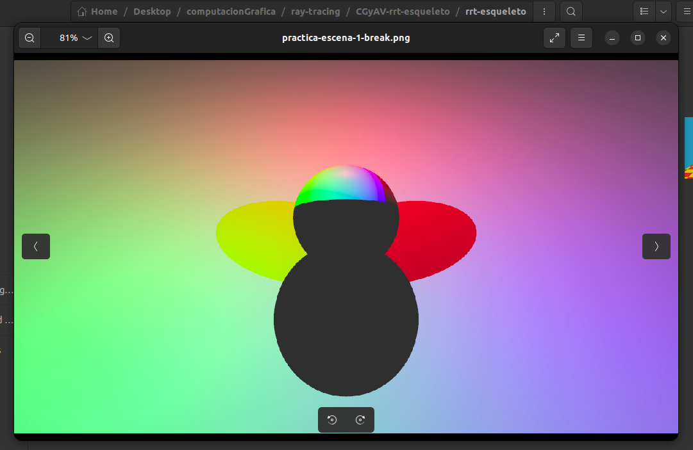
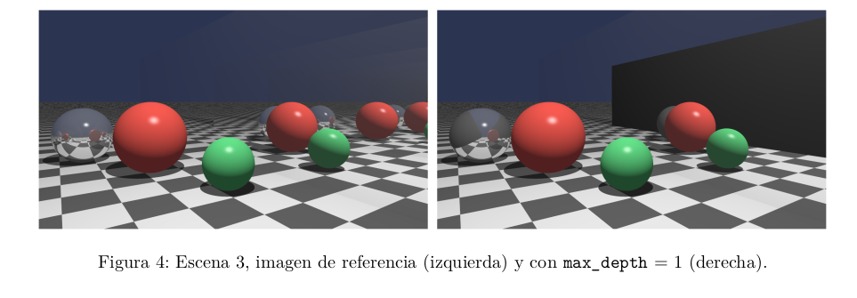
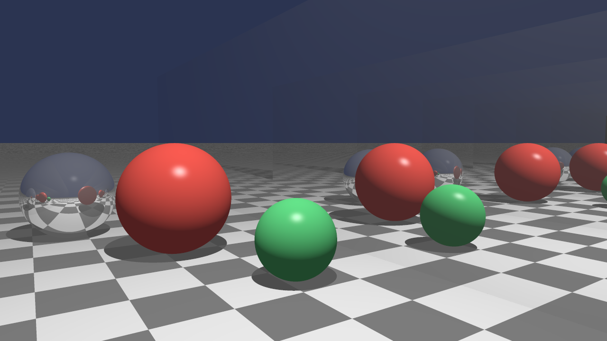

# Practica

## Escena 1

Donde sólo se bloquea la luz roja, la sombra es cian (verde más azul); donde sólo se bloquea la verde,
magenta; y donde sólo se bloquea la azul, amarilla (recordar Unidad III - Teoría del color). Fuera de
las sombras el piso recibe las tres luces, pero cada una se atenúa con la distancia, por lo que su color
tiende al de la luz más cercana. Debajo de la esfera, donde se bloquean las tres, queda sólo el término
ambiental.
Si en el bucle de luces el punto en sombra termina el cálculo (break en lugar de continue), la sombra
de la primera luz de la lista sale negra, la de la segunda queda del color de la primera y la de la tercera
no cambia.

### Preguntas

1. ¿De qué color es la zona donde se bloquean a la vez la luz roja y la verde?

Bloquear significa que no llega ninguno de los colores, por lo tanto abajo a la derecha veo que el color es `azul`

### Break en lugar de continue

Veamos que pasa si hacemos eso de continue

La diferencia ocurre porque continue solo saltea la luz actual que está tapada y sigue revisando las demás, mientras que break corta todo el ciclo for por completo, ignorando las luces que quedan más adelante en la lista

## Escena 2: Espejos paralelos

La cantidad de copias que se ven es igual a max_depth, y más allá de la última el espejo aporta negro,
por lo que el piso reflejado termina en un borde recto. Cada copia se ve más oscura que la anterior,
con la caída dominada por 0,8n . Si el trazador no multiplica por kr en la recursión, todas las copias
tienen el mismo brillo.

## Preguntas
1. Con kr = 0,8, ¿a partir de qué rebote la contribución de una copia cae por debajo del 1 %?
¿Cuánto aporta todavía la última copia con max_depth = 8?

Como la luz de cada copia tras $n$ rebotes llega multiplicada por $kr^n$, para saber cuándo cae por debajo del $1\%$ ($0,01$) con $kr = 0,8$ se plantea la desigualdad:   $$0,8^n < 0,01$$

Despejando $n$ mediante logaritmos naturales:   $$n > \frac{\ln(0,01)}{\ln(0,8)} \approx 20,6$$

Al tratarse de una cantidad entera de rebotes, la contribución cae por debajo del $1\%$ a partir del rebote 21.   Por otro lado, con max_depth = 8, la última copia visible corresponde al octavo rebote y todavía aporta alrededor del 17% ($0,8^8$). Al conservar aún esa intensidad y pasar de golpe a negro en el siguiente nivel truncado, el piso reflejado termina en un borde o corte abrupto.   

2. ¿Qué ventaja tendría cortar la recursión cuando el peso acumulado por los rebotes es menor que
un umbral en lugar de usar una profundidad fija?

Cortar cada rama cuando el peso acumulado cae por debajo de un umbral (técnica conocida como control adaptativo de la profundidad, de Hall y Greenberg) detiene la recursión justo cuando el rayo ya no puede modificar el color del píxel de forma visible:   

Ahorro de cómputo en superficies poco reflectantes: Cuando un material refleja poca luz, la recursión se corta enseguida y se evita gastar tiempo trazando rayos innecesarios hasta alcanzar una profundidad máxima fija.   

Sin cortes abruptos en espejos muy reflectantes: En superficies casi perfectamente reflectantes, el trazador continúa rebotando más niveles de manera automática hasta que el aporte se vuelve imperceptible, evitando los cortes bruscos en los reflejos.   

## Escena 3 Pasillo de espejos

Este fue el reusltado

### Preguntas
1. Con max_depth = 1, ¿por qué la pared se ve casi negra donde el rayo reflejado llega a la pared
opuesta?

Al seguir el recorrido de un rayo desde la cámara en Scene::trace:   
* `depth = 0:` El rayo primario choca contra la primera pared espejo, evalúa su iluminación local (casi nula, ya que kd = 0.02 y ka = ks = 0) y dispara un primer rayo reflejado con depth = 1.   

* `depth = 1:` Si ese rayo reflejado sale del pasillo hacia el piso o el fondo, devuelve sus colores normales (por eso en la imagen de la derecha se alcanza a ver una primera copia reflejada de las esferas y del tablero). En cambio, si choca contra la pared espejo opuesta, suma su tenue aporte difuso local (kd = 0.02) e intenta lanzar un segundo rebote con depth = 2.   

* `depth = 2:` Al entrar en trace con depth = 2, se cumple depth > max_depth_ (2 > 1) y la recursión se trunca devolviendo negro (0, 0, 0). Como el segundo rebote no aporta luz, toda la zona de la pared donde el rayo refleja hacia el espejo de enfrente queda pintada únicamente con su gris muy oscuro de kd

2. La esfera espejo refleja toda la escena. ¿Por qué necesita además un ks distinto de cero para que
se vea el brillo de la luz?

En un trazador de Whitted, las luces (Light) son puntos matemáticos sin área ni radio que no existen como objetos geométricos dentro de objects_:   

* Cuando se dispara un rayo reflejado, find_nearest busca intersecciones únicamente contra superficies geométricas (esferas, planos o triángulos), por lo que un rayo secundario nunca va a intersectar un foco puntual.   

* La única forma de simular el reflejo directo de la lámpara sobre el espejo es calcularlo analíticamente en local_terms mediante el término especular de Phong (m.ks * k_spec * Li). Si ks fuera cero, el punto de brillo blanco de la luz desaparecería de la esfera

3. Si se invierte el orden de los vértices de los triángulos de una pared, ¿cambia la imagen?

La imagen no cambia. Invertir el orden de los vértices (por ejemplo, pasar de a-b-c a a-c-b) invierte el sentido del producto cruz con el que se calcula la normal geométrica del triángulo ($\mathbf{n} \rightarrow -\mathbf{n}$), pero en este motor ese cambio no afecta el resultado por dos motivos:

* La intersección rayo-triángulo no descarta caras traseras (backface culling), por lo que ambos lados del triángulo siguen detectando impactos.

* Tanto al calcular la iluminación local (h.n ya orientada hacia el observador v) como al calcular la dirección del rayo reflejado, el trazador orienta automáticamente la normal para que apunte hacia el lado desde donde viene el rayo incidente. Por esa misma razón ambas paredes del pasillo funcionan mirando hacia adentro pese a haberse creado con exactamente el mismo orden a-b-c y a-c-d.